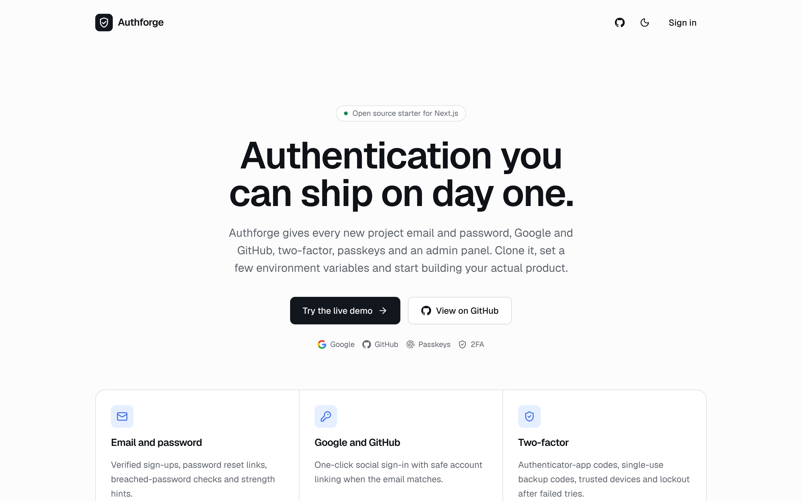
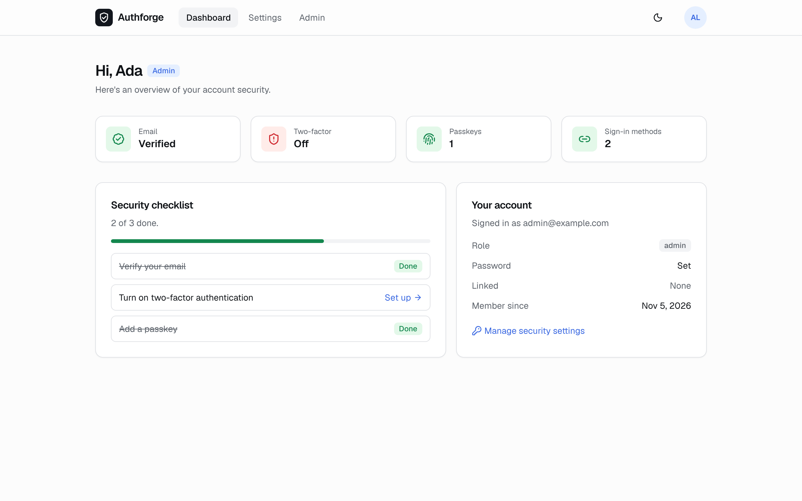
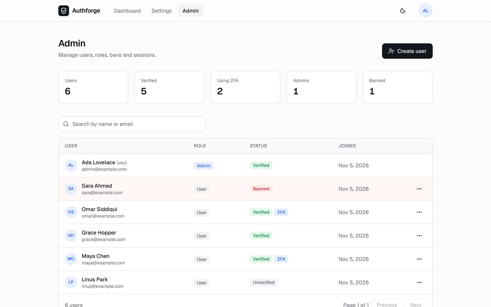
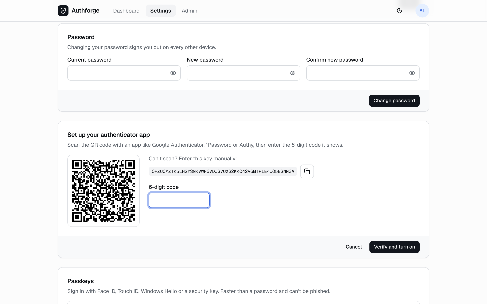
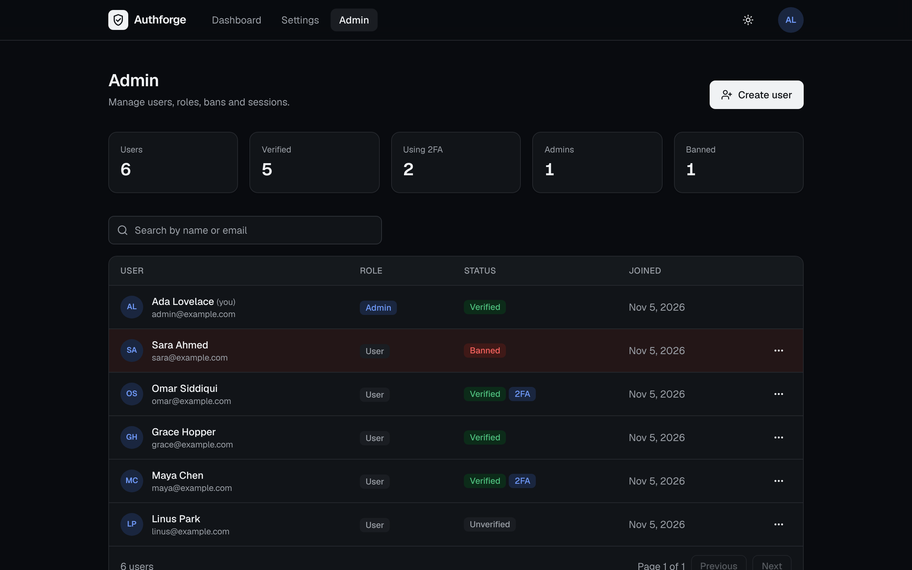

<div align="center">


# Authforge

**Production-ready authentication for Next.js. Clone it at the start of a project and skip weeks of auth work.**

Email and password · Google and GitHub · Two-factor · Passkeys · Roles and an admin panel

[Live demo](https://getauthforge.vercel.app) · [Quick start](#quick-start) · [Deploy](#deploy-to-vercel) · [How it works](#how-it-works)

[](https://github.com/Shahryartariq/authforge/actions/workflows/ci.yml)




</div>

## Why

Every new app needs the same auth work: sign-up with email verification, password reset, social login, 2FA, sessions you can revoke and somewhere to manage users. Authforge is that work done once, tested end to end and kept small enough to read in an afternoon. It's a starter you own, not a hosted service, so there's no per-user pricing and no vendor lock-in.

## Features

| | |
| --- | --- |
| **Email and password** | Required email verification, password reset with single-use links that expire in 1 hour, a strength meter, and a [Have I Been Pwned](https://haveibeenpwned.com/Passwords) check that rejects breached passwords (your password never leaves the server) |
| **Google and GitHub** | One-click sign-in that shows up automatically when you add credentials. Accounts link safely when the email matches, and a "Last used" hint appears on the sign-in page |
| **Two-factor (TOTP)** | QR setup for any authenticator app, 10 single-use backup codes, a 30-day trusted-device option and a lockout after repeated wrong codes |
| **Passkeys** | Face ID, Touch ID, Windows Hello and security keys, including passkey autofill in the browser's email field |
| **Roles and admin panel** | Search users, promote or demote admins, ban temporarily or permanently, sign a user out everywhere, impersonate to debug, create and delete users |
| **Account settings** | Change name and password, manage 2FA and passkeys, connect or disconnect Google and GitHub, see and revoke active sessions, delete the account after an email confirmation |
| **Security defaults** | Rate limits stored in Postgres (so they hold across serverless instances), secure HTTP-only cookies, CSRF protection, open-redirect guards, a strict CSP and security headers, and env validation at startup |

## Screenshots

| Dashboard | Admin panel |
| --- | --- |
|  |  |
| **Two-factor setup** | **Dark mode** |
|  |  |

## Tech stack

- **[Next.js 16](https://nextjs.org)** (App Router, Cache Components, `proxy.ts`) and **React 19**
- **[Better Auth](https://better-auth.com)** with the two-factor, passkey, admin, last-login-method and HIBP plugins
- **[Drizzle ORM](https://orm.drizzle.team)** and **PostgreSQL**: pure TypeScript, with no binary engine and fast serverless cold starts
- **[Resend](https://resend.com)** for transactional email
- **Tailwind CSS v4**, **Zod**, **Vitest** and GitHub Actions CI

## Quick start

You need Node 20.9+, pnpm and a Postgres database. A free [Neon](https://neon.tech) database works well.

```bash
npx degit Shahryartariq/authforge my-app
cd my-app
pnpm install
pnpm env:setup        # creates .env with a fresh secret
```

Open `.env`, set `DATABASE_URL`, and add your email to `ADMIN_EMAILS`. Then run:

```bash
pnpm db:migrate
pnpm dev
```

Open http://localhost:3000 and sign up. Without `RESEND_API_KEY`, the verification email is printed in your terminal: click the link there.

## Environment variables

| Variable | Required | What it does |
| --- | --- | --- |
| `DATABASE_URL` | Yes | Postgres connection string |
| `BETTER_AUTH_SECRET` | Yes | 32+ random characters (`openssl rand -base64 32`). Signs sessions and tokens |
| `BETTER_AUTH_URL` | Production | Public URL of the app. On Vercel it falls back to the production domain |
| `ADMIN_EMAILS` | No | Comma-separated emails that get the admin role when they sign up |
| `RESEND_API_KEY` / `EMAIL_FROM` | Production | Sends verification, reset and delete emails |
| `GOOGLE_CLIENT_ID` / `GOOGLE_CLIENT_SECRET` | No | Turns on Google sign-in |
| `GITHUB_CLIENT_ID` / `GITHUB_CLIENT_SECRET` | No | Turns on GitHub sign-in |
| `PWNED_PASSWORD_CHECK` | No | `true` by default. Set it to `false` only offline |
| `REQUIRE_EMAIL_VERIFICATION` | No | `true` by default. Set it to `false` for a demo with no email provider (see below) |

A missing or malformed value stops the app at startup with a clear message. See [`.env.example`](.env.example).

### Demo mode (no email provider)

The [live demo](https://getauthforge.vercel.app) runs with `REQUIRE_EMAIL_VERIFICATION=false` and no Resend key, so visitors can try every feature without a real inbox. In this mode:

- New accounts can sign in right away, without verifying their email.
- `ADMIN_EMAILS` only applies to Google or GitHub sign-ups (where the provider has verified the email), so nobody can claim admin by typing the admin's address.
- Password reset links can't be sent, and the reset page says so.
- Deleting an account happens immediately after the password check, instead of waiting for an email confirmation.

Keep verification on for a real app.

### Setting up Google and GitHub

- **Google:** create an OAuth client ID (type *Web application*) in the [Google Cloud console](https://console.cloud.google.com/apis/credentials). Authorized redirect URI: `https://your-domain/api/auth/callback/google`
- **GitHub:** create an OAuth app in [Developer settings](https://github.com/settings/developers). Callback URL: `https://your-domain/api/auth/callback/github`

Add `http://localhost:3000/...` versions of these URLs for local development.

## Deploy to Vercel

[](https://vercel.com/new/clone?repository-url=https%3A%2F%2Fgithub.com%2FShahryartariq%2Fauthforge&env=DATABASE_URL,BETTER_AUTH_SECRET,ADMIN_EMAILS,RESEND_API_KEY,EMAIL_FROM&envDescription=See%20.env.example%20for%20what%20each%20one%20does&project-name=authforge)

1. Click the button, or import the repo in Vercel.
2. Add a Neon database from the Vercel Marketplace, or paste any `DATABASE_URL`.
3. Set `BETTER_AUTH_SECRET`, `ADMIN_EMAILS`, `RESEND_API_KEY` and `EMAIL_FROM`. For `EMAIL_FROM`, verify your sending domain in Resend first.
4. Deploy. Production builds run `pnpm db:migrate` first (see [`vercel.json`](vercel.json)), so the tables are created for you. Preview builds don't touch the database.

## Using it in a new project

1. Rebrand in [`src/lib/site.ts`](src/lib/site.ts) (name, description, repo link) and change the colors in [`src/app/globals.css`](src/app/globals.css).
2. Add your app's tables to [`src/db/schema.ts`](src/db/schema.ts) or a new file, then run `pnpm db:generate && pnpm db:migrate`.
3. Protect pages and Server Actions with the helpers in [`src/lib/session.ts`](src/lib/session.ts):

```tsx
// A protected Server Component. Wrap it in <Suspense> (Cache Components).
import { eq } from "drizzle-orm";
import { db } from "@/db";
import { project } from "@/db/app-schema"; // your own table
import { requireSession } from "@/lib/session";

export async function Projects() {
  const { user } = await requireSession("/projects");
  const rows = await db.select().from(project).where(eq(project.ownerId, user.id));
  // ...
}
```

```ts
// A Server Action that only admins can run
"use server";
import { requireAdmin } from "@/lib/session";

export async function deleteProject(id: string) {
  await requireAdmin();
  // ...
}
```

4. On the client, use `authClient` from [`src/lib/auth-client.ts`](src/lib/auth-client.ts), for example `const { data } = authClient.useSession()`.
5. Add a protected route prefix to the `matcher` in [`src/proxy.ts`](src/proxy.ts).

If you change the auth config (for example, by adding a Better Auth plugin), run `pnpm auth:schema` and then `pnpm db:generate` to update the schema and create a migration. CI fails if the schema and config drift apart.

## How it works

```
Browser ──► src/proxy.ts ──────────► fast cookie check, redirects signed-out users
   │
   ├──► /api/auth/[...all] ────────► Better Auth (sign-in, 2FA, passkeys, admin API)
   │                                   └─ Drizzle ─► Postgres (users, sessions, rate limits)
   │
   └──► Server Components ─────────► src/lib/session.ts  (the real authorization check)
```

- **Two layers of protection.** The proxy only checks that a session cookie exists, so redirects are instant. Every protected page, Server Action and admin query also calls `requireSession()` or `requireAdmin()`, which validates the session against the database. The admin API endpoints enforce the admin role on the server too.
- **Cache Components.** Pages that read the session stream in behind `<Suspense>`, so the static shell (header, layout, skeletons) loads at once.
- **Sessions** last 7 days and refresh daily. Every request checks the session in the database (no cookie cache), so signing out other devices, changing a password or banning a user takes effect immediately.
- **Email verification** is required before password sign-in. Signing in unverified sends a fresh link. Clicking it verifies the email and signs the user in.

## Project structure

```
src/
├── app/
│   ├── (auth)/          sign-in, sign-up, forgot/reset password, two-factor, verify-email
│   ├── (app)/           dashboard, settings, admin (signed-in area)
│   └── api/auth/        Better Auth route handler
├── components/          auth forms, settings sections, admin table, UI primitives
├── db/                  Drizzle client and generated schema
├── lib/
│   ├── auth.ts          server auth config: the one file to tweak
│   ├── auth-client.ts   browser client
│   ├── session.ts       requireSession / requireAdmin
│   ├── env.ts           validated environment
│   └── email/           Resend sender and email templates
└── proxy.ts             optimistic route protection
drizzle/                 SQL migrations
scripts/                 env:setup, admin:promote
```

## Scripts

| Command | What it does |
| --- | --- |
| `pnpm dev` | Start the dev server |
| `pnpm build` / `pnpm start` | Production build and server |
| `pnpm lint` / `pnpm typecheck` / `pnpm test` | Quality checks (also run in CI) |
| `pnpm db:migrate` | Apply migrations |
| `pnpm db:generate` | Create a migration after a schema change |
| `pnpm db:studio` | Browse the database |
| `pnpm auth:schema` | Regenerate the Drizzle schema from the auth config |
| `pnpm admin:promote you@example.com` | Make an existing user an admin |
| `pnpm env:setup` | Create `.env` with a fresh secret |

## Testing

`pnpm test` runs the unit tests for validation, redirect safety, error messages and user-agent parsing. Every flow was also checked end to end in a real browser against Postgres: sign-up and verification, blocked unverified sign-in, wrong and correct passwords, 2FA setup and sign-in, passkey registration and sign-in, banning, impersonation, password reset, the open-redirect guard and rate limiting (the sixth sign-in attempt in a minute gets a 429).

## License

[MIT](LICENSE). Use it for anything.
